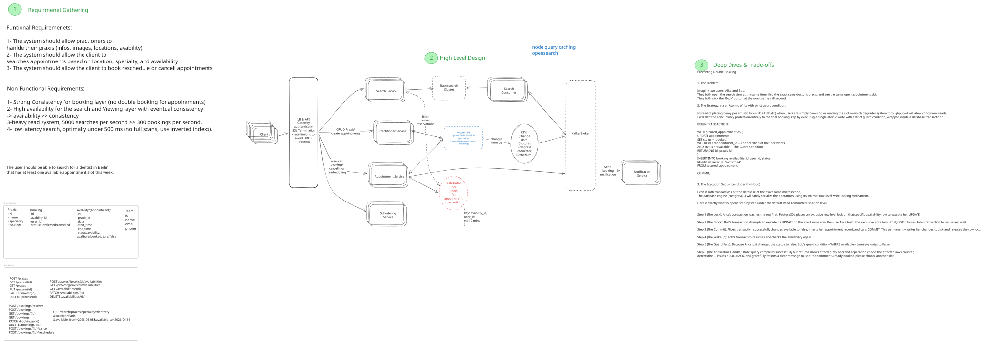

# Doctor Appointment Booking System



## 1. Product Scope

The system supports the discovery and management of doctor appointments. Practitioners manage their practices and appointment availability, while clients search for suitable appointments and manage their bookings. The core design challenge is combining fast, highly available search with a strongly consistent booking flow that prevents double booking.

### In scope

- Managing practice information, images, locations, and specialties.
- Creating and managing discrete appointment slots.
- Searching by location, specialty, and availability.
- Temporarily reserving and confirming an appointment.
- Cancelling and rescheduling bookings.
- Sending booking-related notifications.

### Out of scope

- Payments and billing.
- Insurance eligibility and claims.
- Referrals and medical records.
- Video consultations.

## 2. Clarifying Questions and Assumptions

### Scale and performance

- The workload estimate is **5,000 searches per second** and **300 bookings per second**.
- Search should normally complete in **under 500 ms**.
- The system is read-heavy; search traffic is much greater than booking traffic.
- Data volume, geographic distribution, retention period, and peak-to-average traffic ratio still need product measurements before capacity planning.

### Consistency and availability

- Booking requires strong consistency: at most one confirmed booking may exist for a slot.
- Search favors availability and may be eventually consistent with PostgreSQL.
- PostgreSQL is the source of truth for practices, slots, and bookings. OpenSearch is a derived search view.
- A Redis hold may improve the booking experience, but the guarded PostgreSQL write remains the correctness boundary.
- The stated 10-minute hold duration is a product assumption and should be validated against observed completion times.

## 3. Requirements

### Functional requirements

- Practitioners can create and update practice information, locations, images, specialties, and appointment slots.
- Clients can search for practices with available slots by location, specialty, and date range.
- Clients can view current slot details.
- Clients can temporarily reserve a slot, confirm a booking, cancel it, or reschedule it.
- The system sends booking-related notifications asynchronously.

### Non-functional requirements

- Prevent double booking under concurrent requests.
- Keep search highly available and tolerate a short indexing delay.
- Target sub-500 ms search latency without scanning the transactional database.
- Scale search and booking independently.
- Make retries safe for booking and notification operations.
- Preserve an auditable state transition for each booking.

## 4. High-Level Architecture

The transactional path and the search path are deliberately separated. PostgreSQL owns authoritative state. Debezium captures committed changes and publishes them through Kafka; a search consumer transforms those events and updates OpenSearch. Search can therefore remain fast and available even though its results may briefly lag behind the booking database.

### Main request paths

**Search:** The client calls the Search Service through the API Gateway. The service queries OpenSearch for practices matching the requested specialty and location with at least one active slot in the requested date range. Because the index is eventually consistent, the client must revalidate the selected slot before booking.

**Booking:** The Appointment Service optionally creates a short-lived Redis hold, then executes a guarded transaction in PostgreSQL. Only a transaction that changes the slot from `available` to `booked` may create the confirmed booking.

**Indexing and notifications:** Debezium publishes committed database changes to Kafka. Independent consumers update OpenSearch and send notifications. Consumer retries do not delay the synchronous booking response.

## 5. Data Model

```text
Praxis {
  id
  name
  specialty
  location
  images
}

AppointmentSlot {
  id
  praxis_id
  date
  start_time
  end_time
  status        // available | held | booked | cancelled
  version
}

Booking {
  id
  appointment_slot_id
  user_id
  status        // confirmed | cancelled
  idempotency_key
  created_at
  updated_at
}

User {
  id
  name
  email
  phone
}

TemporaryHold {
  appointment_slot_id
  user_id
  expires_at    // 10-minute TTL assumption
}
```

Important constraints:

- `Booking.appointment_slot_id` should have a database constraint that prevents more than one active confirmed booking for a slot.
- `Booking.idempotency_key` should be unique within the booking operation's scope.
- Slot times should use an unambiguous time representation and retain the practice's time zone for display and scheduling rules.

## 6. Deep Dive

### Why the naive approach fails

A naive implementation reads a slot, observes `available`, and later inserts a booking. Two requests can read the same state before either writes, so both may create a booking. Checking availability in application code does not make the read and write atomic.

Using a long-lived pessimistic lock while a user views or fills out a booking flow is also undesirable. It holds scarce database resources across network and user think time, reduces throughput, and creates difficult failure recovery.

### Preventing double booking with a guarded write

The final transition is a single atomic update with a guard condition, executed in the same transaction as the booking insert:

```sql
BEGIN;

WITH secured_slot AS (
    UPDATE appointment_slots
       SET status = 'booked'
     WHERE id = :appointment_slot_id
       AND status = 'available'
    RETURNING id
)
INSERT INTO bookings (
    appointment_slot_id,
    user_id,
    status,
    idempotency_key
)
SELECT id, :user_id, 'confirmed', :idempotency_key
  FROM secured_slot;

COMMIT;
```

PostgreSQL serializes competing updates to the same row. The first transaction changes the slot state. When a competing update resumes, its `status = 'available'` predicate no longer matches, so it returns no row and creates no booking. The service treats that outcome as a conflict and asks the client to choose another slot.

The schema constraint on active bookings is a second line of defense. Correctness should not depend solely on application behavior.

### Temporary holds

Redis can store `appointment_slot_id -> user_id` with a 10-minute TTL to reduce the chance that another client starts booking a slot already in progress. This is a user-experience optimization, not proof of ownership:

- A Redis failover or expiry must not allow double booking.
- A client presenting a hold must still pass the PostgreSQL guarded write.
- Hold creation and release operations should be atomic.
- Expired holds need no database rollback because they have not confirmed a booking.

If strict temporary exclusivity becomes a product requirement, the hold itself should become authoritative transactional state rather than a best-effort cache entry.

### Retry and idempotency behavior

Clients may retry after a timeout without knowing whether the first request committed. Each booking command carries an idempotency key. The service stores the key with the booking and returns the original result when the same command is retried.

Cancellation and rescheduling should also use explicit state transitions and idempotency keys. Rescheduling is one business operation involving an old and a new slot; its exact transactional policy must be defined. A safe default is to acquire the new slot before releasing the old one, in a short database transaction with a deterministic row-access order.

Notification consumers use the booking or event identifier as a deduplication key. Delivery remains at least once, while duplicate user-visible messages are suppressed by consumer-side state or the email provider's idempotency support.

### Search consistency

The search index contains denormalized practice and availability fields. CDC avoids dual-writing PostgreSQL and OpenSearch inside the request path, but introduces indexing lag. Search results are therefore candidates, not booking guarantees. The Appointment Service always checks authoritative state when the user books.

Consumers must tolerate duplicate and out-of-order events. Versioning each aggregate and applying only newer versions prevents an older event from overwriting a newer index document.

## 7. Trade-offs and Scaling

### Main trade-offs

- **PostgreSQL owns booking state.** This provides strong transactional guarantees and straightforward conflict handling, but all authoritative booking writes depend on the primary database.
- **OpenSearch serves discovery queries.** Search can scale independently and efficiently filter by location, specialty, and availability, but results are eventually consistent and require another system to operate.
- **CDC propagates committed changes.** Keeping PostgreSQL as the only synchronous write avoids application-level dual writes, but consumers must handle replay, duplication, ordering, and processing lag.
- **Redis provides temporary holds.** A short-lived hold improves the booking experience, but it introduces another state store and cannot be trusted to prevent double booking.
- **Kafka decouples downstream work.** Search indexing and notifications do not increase booking latency, but consumers must be idempotent and operational lag must be monitored.
- **Availability uses discrete slot records.** Guarded updates are simple and safe, but generating schedules far in advance may create a large number of rows.

### What is sacrificed for simplicity

- The design assumes one primary transactional region; multi-region active-active booking is not addressed.
- Availability is modeled as discrete slots rather than recurring schedule rules and exception calendars.
- Search may show a slot that was just booked because availability favors eventual consistency.
- Redis holds are advisory rather than part of a distributed transaction.

### At 10x scale

- Scale Search Service instances and OpenSearch replicas independently from booking services.
- Partition Kafka topics by practice or slot identifier to retain per-entity ordering.
- Cache stable practice metadata and common search results while keeping availability freshness explicit.
- Add database read replicas for non-authoritative reads, but keep guarded booking writes on the primary.
- Monitor CDC lag, index freshness, booking-conflict rate, consumer retries, and notification backlog.

### At 100x scale

- Partition transactional data by a stable boundary such as geography or practice, while routing all writes for one slot to one owner.
- Separate schedule-generation data from near-term bookable slots and materialize only the required booking horizon.
- Split the search index by geography and define a routing strategy for broad searches.
- Introduce regional cells to limit blast radius and keep most traffic local.
- Revisit cross-region booking and failover semantics explicitly; strong global consistency carries latency and availability costs.

These are scaling directions, not capacity claims. They require measurements of data size, traffic distribution, failure modes, and growth.

## 8. Notes

**Why not query PostgreSQL directly for search?**
The workload is search-heavy and filters across specialty, location, and time. A dedicated inverted index supports those queries without full scans or placing discovery traffic on the booking database.

**How do you guarantee that a slot is not double booked?**
The final state change uses a guarded PostgreSQL update in the same transaction as the booking insert, reinforced by a database uniqueness constraint. Redis is not trusted for correctness.

**What happens when OpenSearch shows stale availability?**
The booking service revalidates the slot in PostgreSQL. If it is no longer available, the guarded update affects no rows and the client receives a conflict response.

**Why use CDC instead of writing to PostgreSQL and OpenSearch from the service?**
CDC avoids a dual-write consistency problem. Once PostgreSQL commits, the change can be replayed until downstream consumers apply it.

**How would rescheduling remain safe?**
Treat it as one idempotent command. Lock or conditionally update the involved slots in a deterministic order, secure the new slot, update the booking, and release the old slot within one short transaction.

**What if Kafka delivers an event twice?**
Consumers record or derive a stable event key and make updates idempotent. Search documents also carry a version so replays and older events cannot regress state.

**Would you keep the 10-minute Redis hold?**
Only if product data shows that it improves completion rates enough to justify the added state and contention. The duration is configurable and does not affect the database guarantee.

**Which signals would you monitor first?**
Search latency and error rate, booking latency and conflict rate, PostgreSQL lock waits, CDC and Kafka lag, OpenSearch indexing failures, Redis hold expiry, and notification delivery failures.
