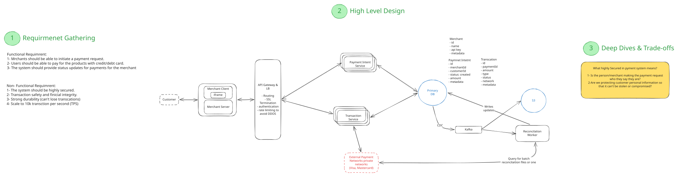

# Payment System

> **Status: work in progress.** The requirements, data model and the merchant authentication deep dive are written up. The remaining deep dives and trade-offs are still in progress.



## 1. Product Requirements

### Functional requirements

- Merchants can initiate a payment request.
- Customers can pay for products with a credit or debit card.
- The system provides payment status updates to the merchant.

### Non-functional requirements

- **Highly secure.** The system must verify that merchants are who they say they are and protect customers' card and personal data.
- **Transaction safety and financial integrity.** A payment must never be charged twice or left in an inconsistent state.
- **Strong durability.** Transactions must never be lost.
- **Scale** to 10,000 transactions per second (TPS).

## 2. Data Model

```text
Merchant {
  id
  name
  apiKey
  secretKey
  metadata
}

PaymentIntent {
  id
  merchantId
  customerId
  status        // created | ...
  amount
  metadata
}

Transaction {
  id
  paymentId
  amount
  type
  status
  network
  metadata
}
```

## 3. Deep Dives and Trade-offs

_In progress._

What does "highly secure" mean in a payment system?

1. Is the person or merchant making the payment request who they say they are?
2. Are we protecting customers' personal information so that it can't be stolen or compromised?

### Is the merchant who they say they are?

How do we ensure the merchant is who they say they are?

- **Authenticity:** the request really came from the registered merchant who wants to make a payment.
- **Integrity:** the request data hasn't been tampered with.
- **Replay attacks:** was this request replayed?

**Request signing:** a combination of the merchant's `X-API-KEY` and private secret key is used to generate signatures.

Example request:

```text
{
  "method": "POST",
  "path": "payment-intent/{paymentIntentId}/transactions",
  "body": {
    // some body ...
  },
  "headers": {
    "X-API-KEY": "pk_live_51NzQRtGswQnXYZ8o",
    "X-REQUEST-Timestamp": "2023-10-15T14:22:31Z", // the time the merchant wants to initiate the payment request
    "X-REQUEST-Nonce": "a1b2c3d4-e5f6-7890-abcd-ef1234567890",
    "X-Signature": "....." // the result from HMAC-SHA256
  }
}
```

```text
HMAC-SHA256(private_key, request) = signature
"sha256=7f83b1657ff1fc53b92dc18148a1d65dfc2d4b1fa3d677284addd200126d9069"
```

When the API Gateway receives a request, it:

1. Retrieves the merchant's secret key based on the `X-API-KEY` (or Bearer token).
2. Recreates the HMAC signature using the same algorithm (SHA-256), secret key and request data.
3. Compares the calculated signature with the one provided in the request headers.
4. Validates that the timestamp is within an acceptable time window (typically 5-15 minutes).
5. Ensures the nonce hasn't been used before within the valid time window by checking the nonce cache in Redis (replay attack prevention).
